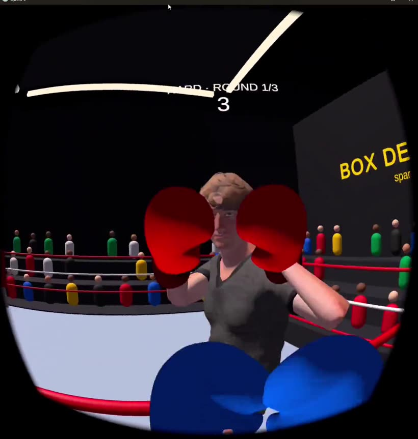
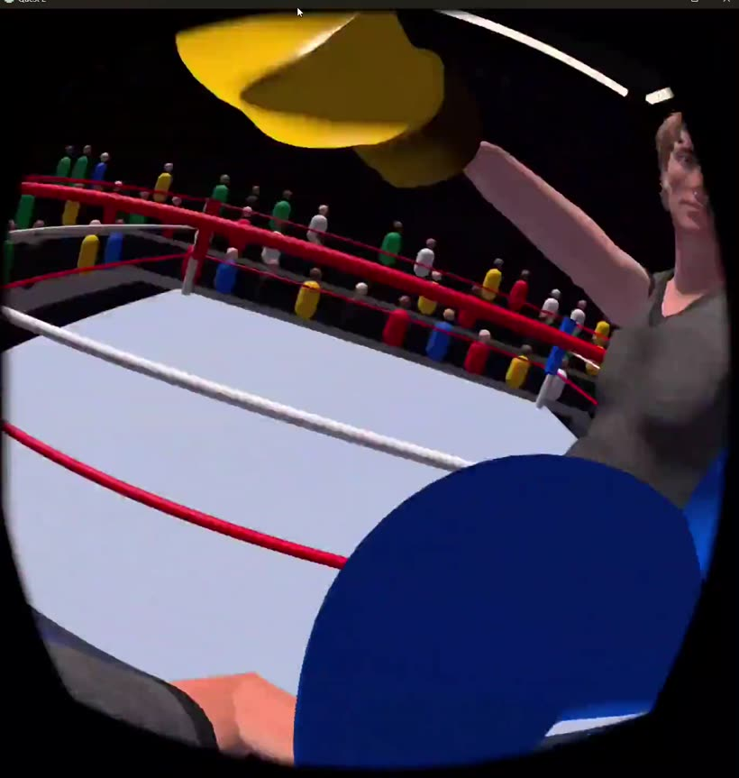
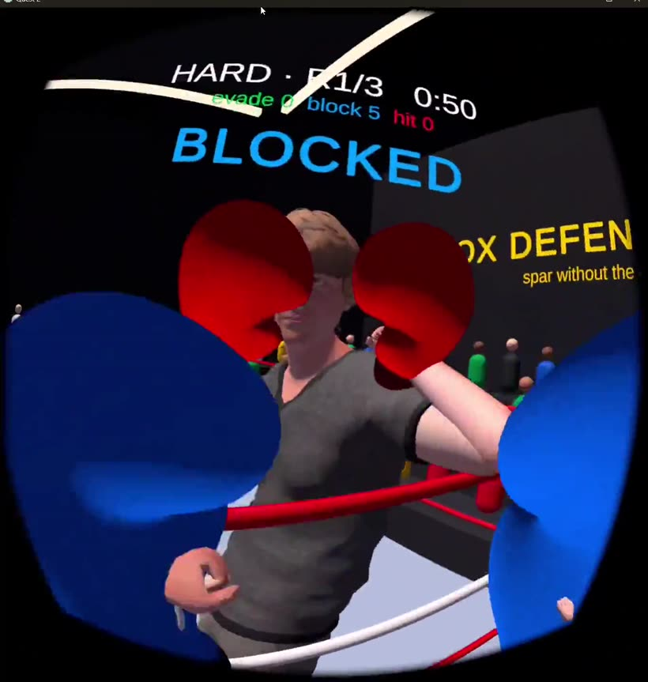
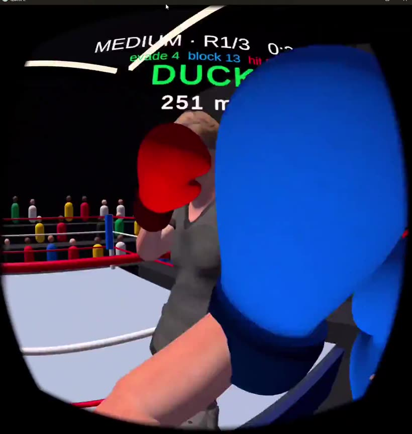

# Post 2: An opponent that punches at your real head

The opponent is the whole product. If his punches aren't readable, the trainer is just a reaction-time test. If they're too readable, there's nothing to train. This post covers how a punch works from start to finish.

## Where he stands

When a round starts, he stands **0.95 m** in front of where you're looking, with his head **10 cm above yours**. I first had him at my height. In the headset that felt short, and a slightly taller opponent also makes you keep your chin down.

During the round he follows you slowly: he keeps the distance but drifts towards you rather than copying every move. So when you slip, your head really leaves the line of the punch. If he tracked you instantly, a slip would be pointless.

## One punch, three phases

**1. Wind-up.** The glove pulls back towards his shoulder and **turns yellow**. This is the "tell", like the shoulder twitch you learn to read in sparring. It's the only warning you get.

**2. Strike.** At the end of the wind-up, he aims at **where your head is at that moment**, plus 12 cm, so the punch goes through you and not just to you. Then he throws:

- **Jabs and crosses** go straight.
- **Hooks** travel on a Bezier curve with the control point 45 cm to the side, so they come round your guard instead of into it.

He also steps in 16 cm behind each punch, which sells the weight of it.

**3. Retract.** The glove comes back to his guard and the next punch or combination begins.

How long each phase takes depends on the level. Easy has a 0.62 s wind-up and Hard 0.34 s. Post 3 covers this.

## What happened to the punch?

On every frame of the strike, three spheres are checked:

| Check | Result |
|---|---|
| His glove (7.5 cm) touches one of your gloves (6.5 cm) | **Blocked** |
| His glove touches your head (11 cm) | **Hit**: the screen flashes red, a thud plays, both controllers buzz |
| Neither, by the end of the strike | You avoided it, and now the question is how |

Block is checked before hit. If your glove is in the way, it was a block, even if your head was close.

If he missed, the code looks at **how your head moved since the wind-up started**, split into three directions relative to him:

- **sideways** (left or right, from your point of view)
- **down**
- **back** (away from him)

The biggest component wins: **SLIP LEFT**, **SLIP RIGHT**, **DUCK** or **PULL BACK**. A move under 5 cm counts as no real move.

This is `DefenceMath.ClassifyEvade`. It's four lines of vector maths, and the self-check has a test for each case.

## Reaction time

From the start of the wind-up, the code waits for your head to move more than 5 cm from where it was. That moment is your **reaction time**, shown under the result ("DUCK 251 ms").

Post 5 has an honest caveat about this number.

## Arms that bend like arms

The first opponent was made of primitives (spheres, capsules and boxes), and only his gloves moved. Floating gloves don't read as punches. So I wrote a **two-bone IK solver** (`DefenceMath.Elbow`). Given a shoulder, a glove position, the upper-arm and forearm lengths, and a hint for which way the elbow points, it returns the elbow position. Every frame, each arm is solved and the capsules are stretched between the shoulder, elbow and glove. The legs use the same solver for the knees.

Later the primitive body was replaced by a real character (Post 4), but the idea didn't change. **The game logic moves the gloves, and the body follows them.** That separation was the most useful decision in the project. The punch logic never needed to know what the body looked like.

## Next

[Post 3](03-training.md): turning this into training, with levels, feints, a Pro mode where you punch back, and coaching after each round.
