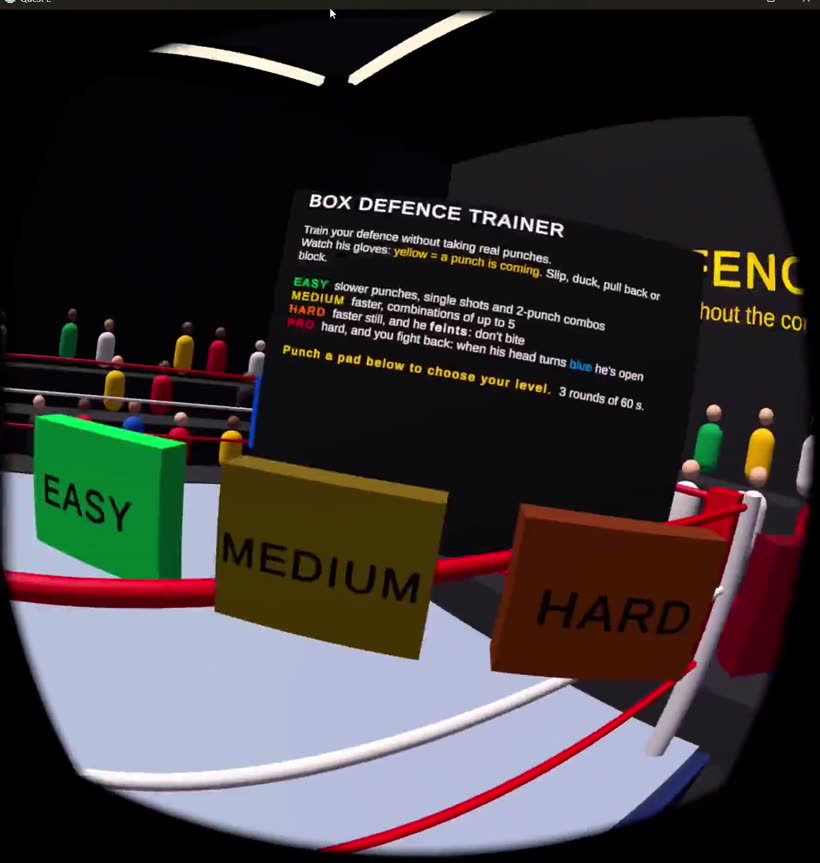
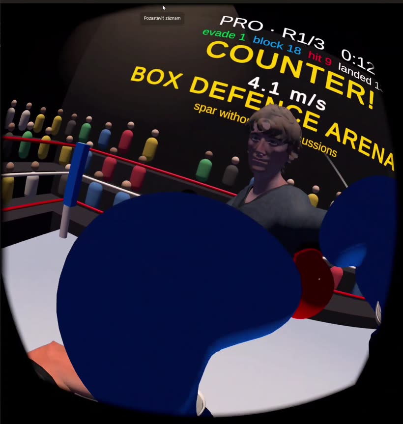
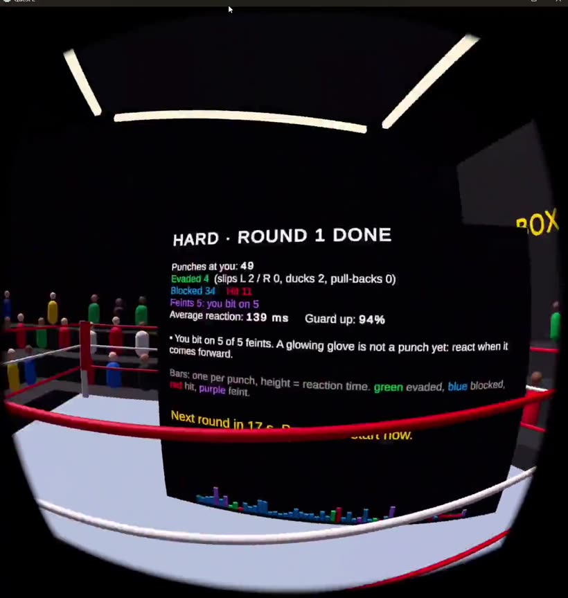

# Post 3: From a toy to a training tool

The first build was fun, and after two rounds it was easy. A training tool has to stay hard, has to cover what real opponents do, and has to tell you what you did wrong. This post covers the four things that got it there.

## 1. Levels you choose by punching

At the start, four pads float in front of you. You choose by **punching one**: a glove has to touch the pad while moving faster than 0.8 m/s, and pads light up when a glove hovers over them. No laser pointer and no menu button, because you're in boxing gloves.

| | Wind-up | Strike | Gap between attacks | Combinations | Feints |
|---|---|---|---|---|---|
| **Easy** | 0.62 s | 0.22 s | 1.5–2.5 s | 30 % chance, 2 punches | none |
| **Medium** | 0.46 s | 0.17 s | 1.0–1.9 s | 55 % chance, 2–5 punches | none |
| **Hard** | 0.34 s | 0.13 s | 0.7–1.4 s | 60 % chance, 2–5 punches | 25 % |
| **Pro** | as Hard | as Hard | 0.8–1.6 s | as Hard | 25 % |

In Pro you also punch back (see section 3).

In a combination, only the first punch has the full wind-up. The rest come off a 60 % wind-up, which is how combinations work in the ring: the first shot is the tell, and the follow-ups come off it.

All the numbers are in one place (`Difficulty.For` in `Records.cs`), so tuning a level is a one-line change.

## 2. Feints

Real opponents don't only throw punches. They show you punches. On Hard and Pro, a quarter of attacks are **feints**:

- the same yellow wind-up with a little shoulder dip
- then he stops, somewhere between 50 % and 75 % of the way through
- 60 % of the time, a real punch follows straight after

If your head moved during the feint, it's recorded as **BIT ON FEINT**. If you held your position, it's **READ FEINT**.

This matters because the main mistake the trainer exists to catch is **reacting to the tell instead of the punch**. In my own first Hard round, I bit on **5 of 5** feints. That's a real habit I didn't know I had, and it's exactly what a sparring partner exploits.

## 3. Pro: you punch back

Defence in boxing isn't just not getting hit. It's getting into a position to hit back. In Pro:

- After any punch you defend, he's **open for 0.9 s**: his hands drop and his head turns blue.
- Your gloves' speed is tracked. A glove moving towards him that touches his head sphere is a **landed punch**, recorded with its speed in m/s. If it lands during his open window, it's a **counter**, and the crowd cheers.
- He defends too. Half the time he reacts to an incoming punch: 60 % of those he blocks, otherwise he slips. You can't just stand and swing.

## 4. It adapts, and it coaches

**Adaptive speed.** Every 6 punches, the session looks at how many you defended:

- 85 % or more: he speeds up a step.
- 40 % or less: he slows down a step.

On top of that, each round is 5 % faster than the last. The wind-up never drops below 0.18 s, which is about the limit of fair.

**Round summary.** After each 60-second round (three per session, with 20 s rest in between), a panel shows:

- how many punches he threw, and what happened to them (blocked, slipped left or right, ducked, pulled back, hit)
- your average reaction time
- **guard up %**: the share of the round both gloves were within 32 cm of your head and no more than 28 cm below it
- one bar per punch, with height showing reaction time and colour showing the outcome: green evaded, blue blocked, red hit, purple feint

Then come **coaching notes**, generated from simple rules in `DefenceMath.Insights`:

| Rule | Example note |
|---|---|
| Hit by 40 % or more of punches | "Start moving on the wind-up, not on the punch." |
| 75 % or more of slips to one side | "80 % of your slips went left. Mix it up, or a real opponent will read it." |
| Bit on half the feints or more | "You bit on 5 of 5 feints. A glowing glove is not a punch yet: react when it comes forward." |
| Guard up under 60 % | "Bring your hands back to your face after every punch." |
| Pro, defended well, never countered | "Punch back in the gap right after a slip or block." |
| Average reaction over 550 ms | "Watch the shoulders and gloves, not the face." |

The rules are deliberately simple and readable. Each one is a habit a coach would point out, and each is tested in the self-check.

## Everything is saved

Every session is written to the headset as JSON, one file per session. It holds every punch (kind, outcome, wind-up and strike time, reaction time, which glove), every punch you landed, and every round summary. Nothing is lost when you take the headset off, and the data can be analysed later.

## Next

[Post 4](04-immersion.md): making it feel like a fight. The arena, the crowd, sound, haptics, and replacing the capsule man with a real body.
