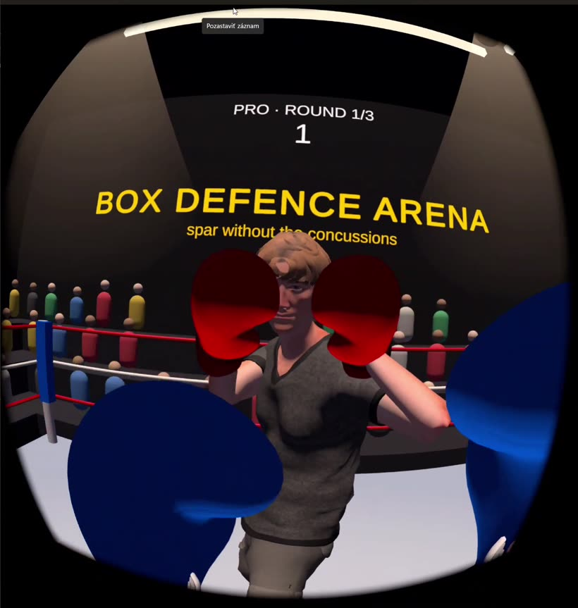
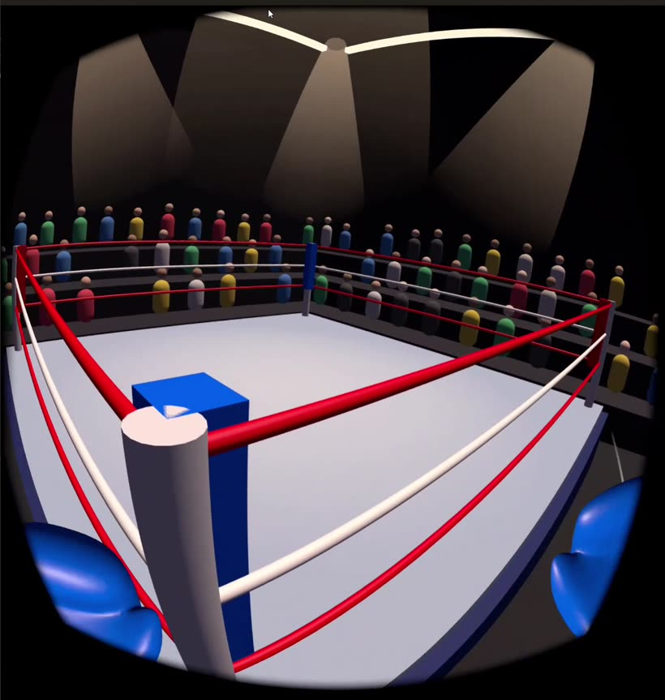
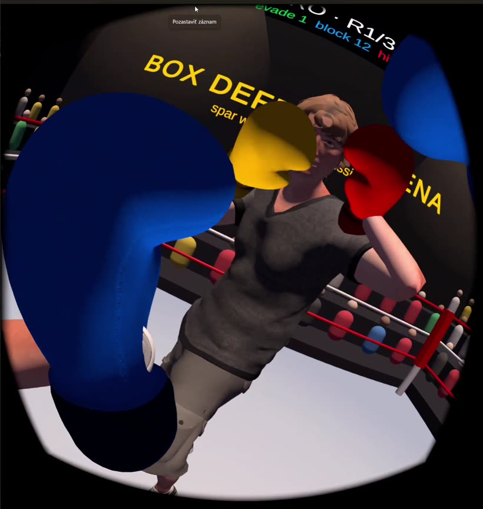
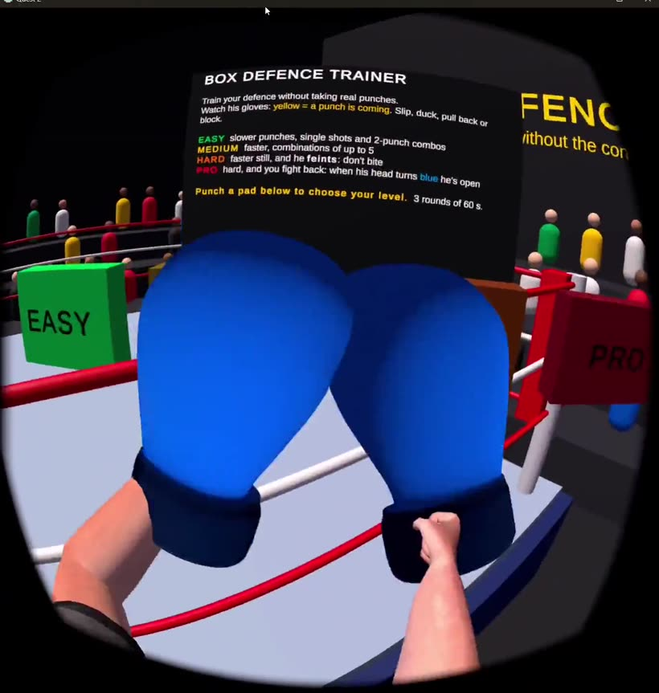

# Post 4: Immersion. Fight night, sound, haptics and a real body

A defence drill works in an empty grey room, but you don't train like you fight there. This post covers everything that makes you forget you're standing in a classroom holding two controllers.

## The arena

You stand in a ring: a raised canvas with ropes, posts and corner pads. Around it are three rows of stands on each side with about **150 fans**, and above it walls, a roof, light bars and a banner.

Everything is generated in code, the fans with a fixed random seed so the crowd is the same every time. Quest 2 is a phone chip driving two screens, so the arena is cheap by design:

- primitives and flat colours instead of textures
- no shadows
- every static object marked for **static batching**, so Unity can combine the crowd and the stands into far fewer draw calls
- linear fog to hide the far walls

### You start in the middle of the ring

In the first version, the ring was fixed in the virtual world, and where you ended up in it depended on where you happened to stand in your real room. In one recording I was half a metre from the ropes.

Now, when the menu opens and again when you choose a level, the whole rig is moved: rotated so you face along the ring, and shifted so you and he stand either side of its centre. Your real room doesn't change. The arena is placed around you, wherever you are. This uses the XR Origin's own `RotateAroundCameraUsingOriginUp` and `MoveCameraToWorldLocation`, and it only happens between rounds, never during one, so it can't make you sick.

### Fight night

The first arena was evenly lit and looked like a gym hall. A fight looks different: a dark hall and a bright ring. So:

- The ambient light is lower, the main light comes almost straight down, and the crowd's colours are darkened. They sit in the shade.
- The canvas glows slightly (a small emission), so the ring reads as the brightest thing in view.
- Four **light beams** come down from the lighting rig: generated cone meshes with an additive material whose transparency, stored in the vertex colours, fades to nothing before head height, so you never stand in a haze. A soft **pool of light** on the canvas is a disc with the same trick.

None of this uses a real-time light beyond the one main light. On a Quest, extra lights are expensive. Additive geometry is almost free.

### A crowd that moves

150 fans made of separate objects would be 300 objects to move every frame. Instead, the scene builder **merges each block of seats into one mesh** (about 36 blocks), with each fan's shirt and skin colour stored in the mesh's vertex colours. The whole crowd uses one material.

`CrowdAnimator` bobs each block on its own rhythm. When the crowd gets excited, they bounce higher and faster:

- a cheer when you start a session or a round ends
- an "ooh" when you get hit
- a big cheer when you land a counter in Pro

The excitement then fades over a couple of seconds.

## Sound without sound files

There isn't a single audio file in the project. Every sound is **synthesised at start-up** from noise, sine waves and envelopes (`Feedback.cs`):

- the bell
- the impact of a hit, the leather smack of a block, and your own punch landing
- the whoosh of a punch
- a looping crowd murmur, a cheer and an "ooh"

The crowd reacts. It cheers when you pick a level and at the end of each round, groans "ooh" when you get hit, and cheers for a clean counter in Pro.

The first impact sounds were a sine wave and a burst of noise. They sounded like a game from 1995. A punch on a recording is really three layers, so each impact is now built the same way (`Synth.Impact`):

1. **A body thump:** a sine wave whose pitch falls quickly, from about 140 Hz to 45 Hz, which gives the weight.
2. **A leather smack:** noise through a low-pass and a high-pass filter, with a very fast decay, which gives the "slap".
3. **A 3 ms crack** at the very start.

All three are pushed through soft saturation (`tanh`), which makes them punchy instead of clean. Getting hit, landing a punch and blocking use different settings: heavier and lower when you're hit, duller for a glove-on-glove block. Each has three slightly different versions, picked at random, so ten blocks in a row don't sound like a loop.

## Impacts you can see

- **Blocks** throw a burst of sparks where the gloves meet: short-lived, stretched particles that streak in the direction they fly.
- **Your punches landing** on him in Pro throw a spray of sweat droplets that fall with gravity.

Both are particle systems that are never "playing". The code emits a burst of 25–30 particles at the contact point when it happens, which costs nothing the rest of the time. There's deliberately no camera shake. Moving the camera without your head moving is the fastest way to make someone sick in VR.

## Haptics

The controllers are the only thing that touch you, so they do the talking:

- **Getting hit:** both controllers buzz hard (0.25 s), the view flashes red and a thud plays.
- **A block:** a short buzz in the glove that took it.
- **Your punch landing** (Pro): a buzz in the glove that landed.

## A real opponent

For most of the project the opponent was a capsule man with IK arms (Post 2). It worked, and it was readable, but it didn't feel like a person. After watching a recording of myself playing, the first item on my list was "a real guy model".

I used **Remy** from Mixamo with the **Fighting Idle** animation, a proper boxing guard that bounces on the spot. Making him fight took a new component, `HumanoidPuppet`:

- The animation plays the idle bounce. Unity's **humanoid IK** then pulls both hands to where the game logic says the gloves are. He punches with his real arms and keeps the bounce in his legs.
- His **body turns into every punch**. On the wind-up, the punching shoulder turns back about 10°. On the punch, his shoulders and hips turn forward: about 14° for a jab, 26° for a cross and 34° for a hook. He also leans 4–8 cm into it. When he slips or flinches, his body leans the same way.
  This is done inside Unity's IK pass: the body rotates around its centre of mass first, the feet are pinned where the animation put them, and only then are the hands solved. If the body were turned afterwards, the hands would swing out of the gloves.
- He's **scaled to your height** at the start of each session.
- His animated head is placed **exactly over the invisible head sphere** the game uses. In Pro, what you see is what you can hit.

The old primitive head and gloves are still there, but invisible: they're the hit volumes. The new body is purely visual. If the model files are missing, the scene builder keeps the primitive body, so the project always builds.

## Your own body

Looking down and seeing nothing breaks presence immediately. So you get a body too: the **same Remy**, standing under the headset, with:

- **his head hidden**, so you don't see inside your own face
- **his hands pulled by IK into your gloves**, so your arms bend at the elbow when you move the controllers
- **the body sinking with you** when you duck, rather than shrinking, so you never see inside your own neck

## Real gloves

The glove is **"Boxing Glove" by Incg5764** on Sketchfab (CC Attribution, about 4,000 triangles). Two problems:

1. **The format.** Sketchfab offered only glTF, GLB, USDZ and .blend, and Unity can't read any of them without plug-ins. I wrote a short Python script that reads the GLB, applies its node transforms and writes a plain OBJ, which Unity imports natively.
2. **The colour.** The red was painted into the texture, and tinting a red texture blue gives near-black. The script builds a new, **white** texture from the original: the red leather becomes white (keeping its wrinkles and shading), and the cuff stays a darker grey. Now one material gives blue gloves for you, red gloves for him, and the **yellow wind-up** still works on his.

The model's longest side is detected and turned to point along the punch, then scaled to 28 cm for his gloves and 24 cm for yours. Your gloves started at 28 cm too, and in the headset they filled half the view.

## The model pipeline took longer than the models

Nothing about the real models worked first time:

| Problem | Cause | Fix |
|---|---|---|
| Remy rendered plain white | Mixamo embeds textures inside the FBX, and Unity didn't unpack them | The builder extracts them and connects each texture to its material by name |
| Risk of hair rendering as solid blocks | Hair is cards with a separate opacity texture | Diffuse and opacity are merged into one RGBA texture, and the hair uses alpha cut-out |
| Risk of a see-through body | Mixamo characters ship opacity maps, and their materials can import as transparent, which sorts badly in VR | All materials are forced opaque before it can show up |
| A 3.3-metre opponent | The FBX's units import with Remy's head at 3.31 m | Height-fitting measures the animated head and scales to you, with a wide enough range |
| Bare fists poking out under the gloves | The IK hand kept the animation's rotation | The hand bones are hidden, because the glove is the hand |

All of these fixes are in `BoxDefenceModels.cs` and run automatically when the scene is built. Nobody needs to repeat them by hand.

## Next

[Post 5](05-results.md): testing it, what the numbers say, and what I'd change.
