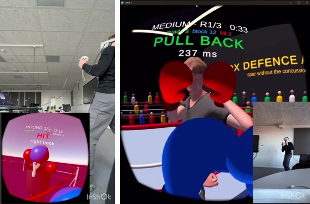
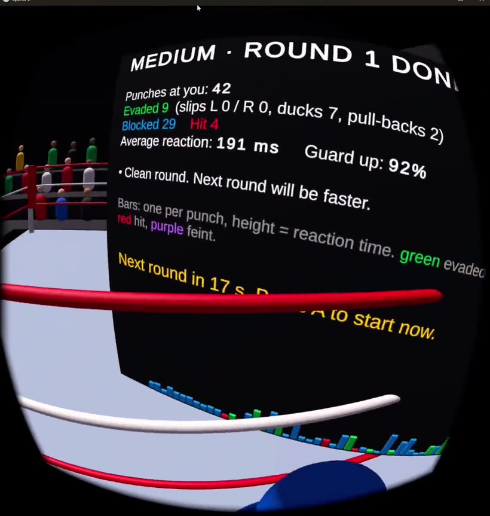
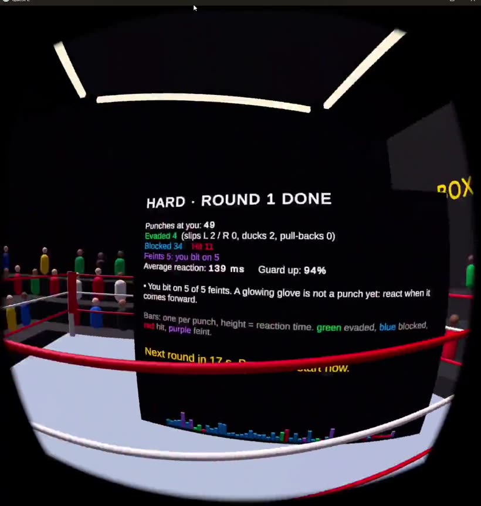
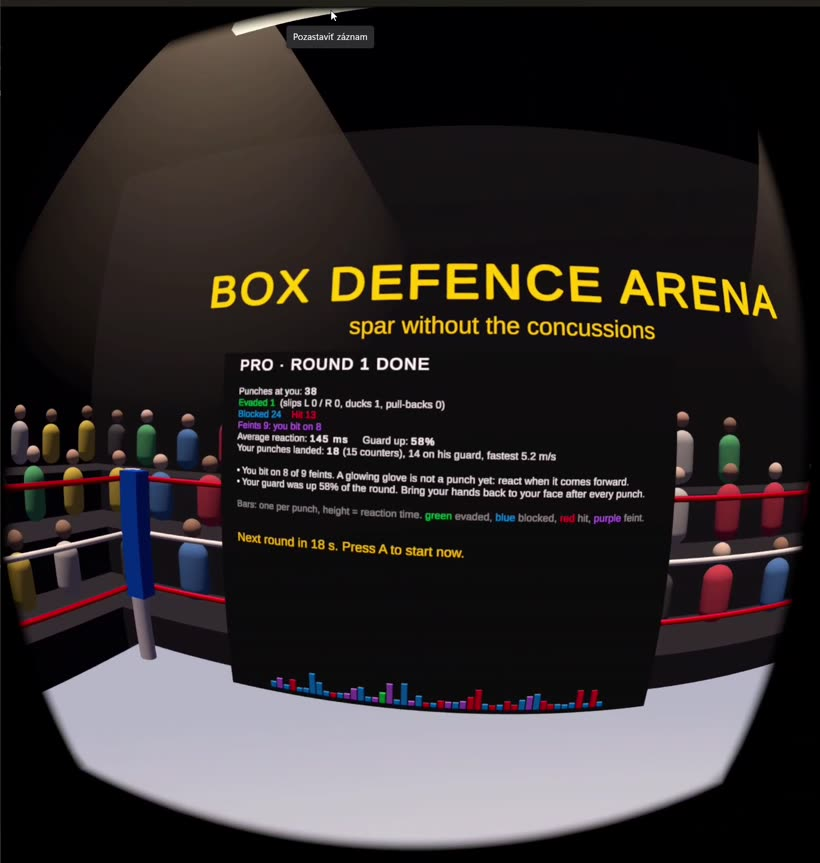
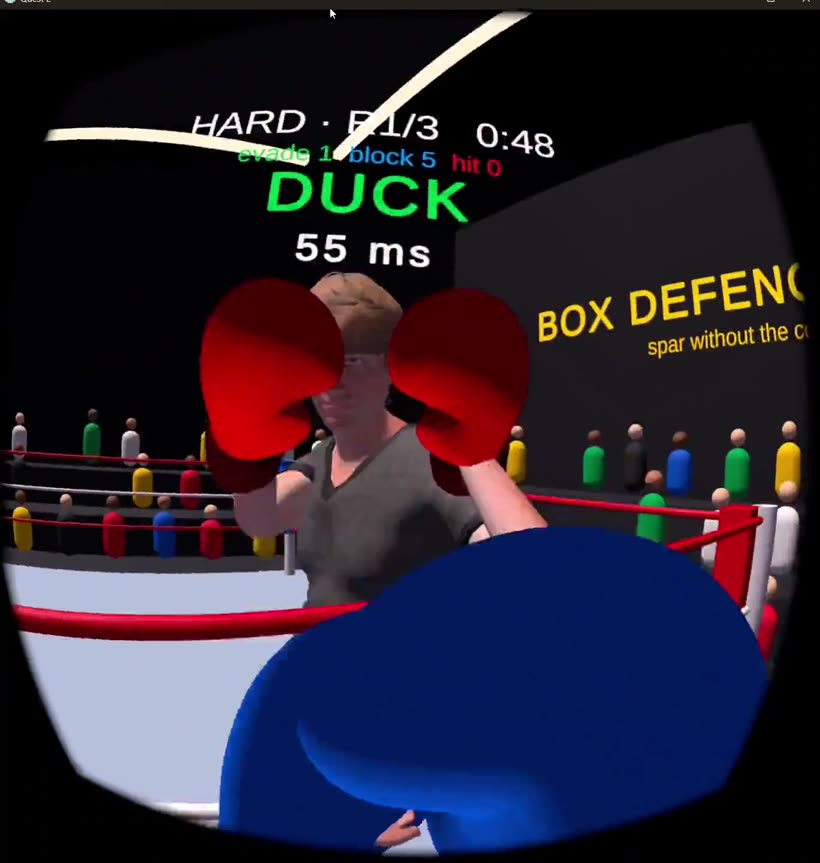

# Post 5: Testing, results and what I'd change

## How it was tested

**In the editor:** `BoxDefence → Run Self-Check` runs **31 checks** on the core logic in under a second, with no headset needed. They cover:

- the outcome classification (a sideways move is a slip in the right direction, a drop is a duck, a step back is a pull-back, a 2 cm wobble is nothing, and leaning into the punch is not a pull-back)
- sphere contact, Bezier paths and reach clamping
- the guard test and the elbow IK (bone lengths are preserved, and the arm goes straight when out of reach)
- the level presets (each level gives less warning and punches faster, only Hard and Pro feint, only Pro lets you punch) and adaptivity (later rounds are faster, struggling slows him down)
- the coaching rules

The current result is 31 passed, 0 failed.

**In the headset:** every change was tested by playing it, with the headset mirrored to the laptop via scrcpy and recorded. Each recording produced the next list of changes:

| Playtest | What I noticed | What changed |
|---|---|---|
| First build | Slips, blocks and pull-backs all register correctly. Punches too slow. Opponent too short (I'm almost 180 cm) | Faster punches. Opponent's head set 10 cm above mine |
| Recording 1 | My big sphere "gloves" blocked half the view | Smaller, glove-shaped gloves |
| Recording 1 | Too easy after two rounds, and too clinical | Four levels, feints, Pro mode, arena with crowd, real models |
| Recording 2 | The real models work. Small bare fists poke out under my gloves, and my gloves still fill a lot of the view | Hands hidden inside the gloves. My gloves shrunk to 24 cm |
| Recording 2 | I sometimes start near the ropes. He punches with only his arms. The hall looks like a gym. Hits sound thin | Centred in the ring, body rotation into punches, fight-night lighting, a moving crowd, sparks and sweat, layered impact sounds (Post 4) |
| Recording 3 | All of the above works. A full Pro round | Nothing broken. The data is below |

From the first build to the final one, filmed in the room at the same time as the headset view:

- **[First build](../Media/real-world-first.mp4)** (13 s): the capsule opponent, sphere gloves, and an early "HIT, right hook".
- **[Final version](../Media/real-world-final.mp4)** (14 s): Remy, real gloves and body, the arena, a pull-back at 237 ms and a run of blocks.

The movement in the room is the same in both. The difference is everything around it.

## Three rounds of data

One round each on Medium and Hard from recording 2, and one on Pro from recording 3:

| | Medium | Hard | Pro |
|---|---|---|---|
| Punches at me | 42 | 49 | 38 |
| Blocked | 29 (69 %) | 34 (69 %) | 24 (63 %) |
| Evaded | 9 (7 ducks, 2 pull-backs) | 4 (2 slips left, 2 ducks) | 1 (a duck) |
| Hit | **4 (10 %)** | **11 (22 %)** | **13 (34 %)** |
| Feints | none on this level | **bit on 5 of 5** | **bit on 8 of 9** |
| Guard up | 92 % | 94 % | **58 %** |
| Average reaction | 191 ms | 139 ms | 145 ms |
| My punches landed | – | – | 18 (15 of them counters), plus 14 on his guard. Fastest 5.2 m/s |

|  |  |  |
|---|---|---|
| Medium | Hard | Pro |

What this says:

- **Each level is harder than the last.** The share of punches that got through went from 10 % to 22 % to 34 %.
- **Attacking costs defence.** In Pro, my guard was up only 58 % of the round, against 92–94 % when I only defended, and I took a third of his punches. That's exactly what happens in real sparring: you throw, your hands are away from your face, and that's when you get hit. The coaching note caught it and told me to bring my hands back to my face after every punch.
- **The feints work.** I bit on 13 of 14 across Hard and Pro. That is the most useful thing the trainer told me: I react to the tell, not the punch.
- **I'm one-sided.** Across all three rounds there were zero slips to the right. In the ring, a predictable slip is a slip someone times a hook to. The coaching rule for one-sided slips needs at least 4 slips to fire, so it stayed quiet here. That threshold is probably too high.
- **A high guard does most of the work.** About 70 % of punches hit my gloves. That's realistic, since a tight guard is the first layer of defence. But it means the trainer currently rewards shelling up. See "What I'd change".

## The honest caveat: reaction time

One duck in the recording shows **55 ms**.

Nobody reacts to a visual cue in 55 ms. Simple visual reaction time is usually quoted at around 200 ms. The average on Hard (139 ms) is below that too.

The reason is how it's measured: the time from the start of the wind-up until my head has moved 5 cm. If I was already moving (bouncing, or anticipating because the last three punches came in a rhythm), that counts as a fast "reaction". So the number is really **movement onset after the tell**. It's still useful, because lower means you were moving earlier, but it isn't pure reaction time.

A better metric would:

- only count movement **in the direction of the final evade**
- **ignore motion already present** before the wind-up (subtract the head's velocity at that moment)
- report **"moved before the tell"** separately, which is itself a habit worth seeing

## Limitations

- **One tester (me), in one session per level.** The numbers show the trainer works and produces sensible data. They don't show that it improves anyone's defence. That would need several people over several weeks, compared with a control group.
- **Controllers aren't gloves.** They're lighter, and there's no glove-on-glove contact, so a block is only a haptic buzz.
- **Head shots only**, and no footwork. He follows you, but you can't move out of range or cut an angle, and he never goes to the body.
- **The head is a sphere.** Good enough for slips and ducks, but a punch that clips the side of the head counts the same as a clean one.
- **I didn't formally profile performance on Quest 2.** It ran smoothly to the eye, but I don't have frame-time measurements.

## What I'd change next

1. **The reaction metric**, as above.
2. **Punches that look for gaps.** He knows exactly where my gloves are. A hook aimed at the open side of the guard, or a body shot when the guard is high, would force head movement instead of letting the guard absorb everything.
3. **Footwork and distance.** He steps in and out, and you have to manage range.
4. **Progress over time.** Every session is already saved as JSON. A history screen (reaction trend, feints bitten, left/right balance per week) is just reading those files.
5. **Weighted gloves or controller straps**, to make blocks and punches feel heavier.

## What VR brought, and what the brief asked for

**The value of VR.** The core of this app can't exist on a flat screen. The opponent aims at your tracked head, and you defend by actually moving it. The headset then turns that movement into data (direction, timing, guard height) that no sparring partner can give you. It's a sparring partner that never hits you, never gets tired, and remembers every punch.

**Spatial interaction.** There are no buttons in the training itself:

- you choose a level by punching a pad
- you defend with your head and your hands
- in Pro, you attack by punching his head, with your glove speed measured

**Immersion:** the arena, crowd, synthesised sound and haptics, a realistic opponent, and a body of your own when you look down (Post 4).

**Modular software.** Three decisions kept it manageable:

- **The core logic has no scene dependencies** (`DefenceMath`, `Records`), so it's testable without a headset.
- **The game logic moves the gloves, and the body follows.** The primitive body was replaced by a full character without touching the punch, hit or classification code.
- **The scene is generated from code**, and the real models are optional. If they're missing, the primitives are used, so the project always builds.

## Demo

- [`Media/demo-pro-with-me.mp4`](../Media/demo-pro-with-me.mp4) (1:32): a full Pro round, with me in the room picture-in-picture.
- [`Media/demo.mp4`](../Media/demo.mp4) (1:14): the final version, with a Pro round under fight-night lighting, counters, and the summary.
- [`Media/demo-v1.mp4`](../Media/demo-v1.mp4) (1:44): the earlier build, with Hard and Medium rounds, the telegraph, feints and ducks.
