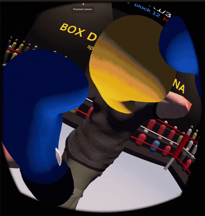
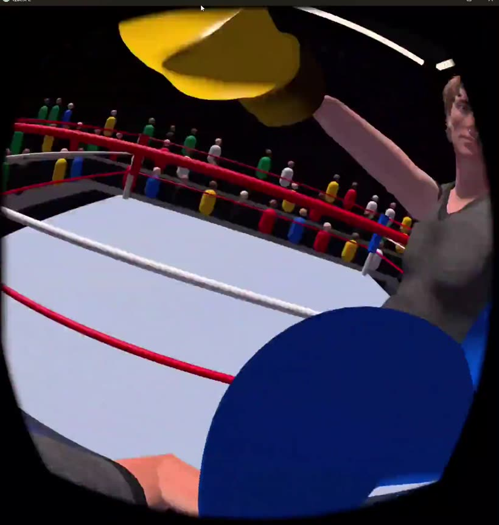
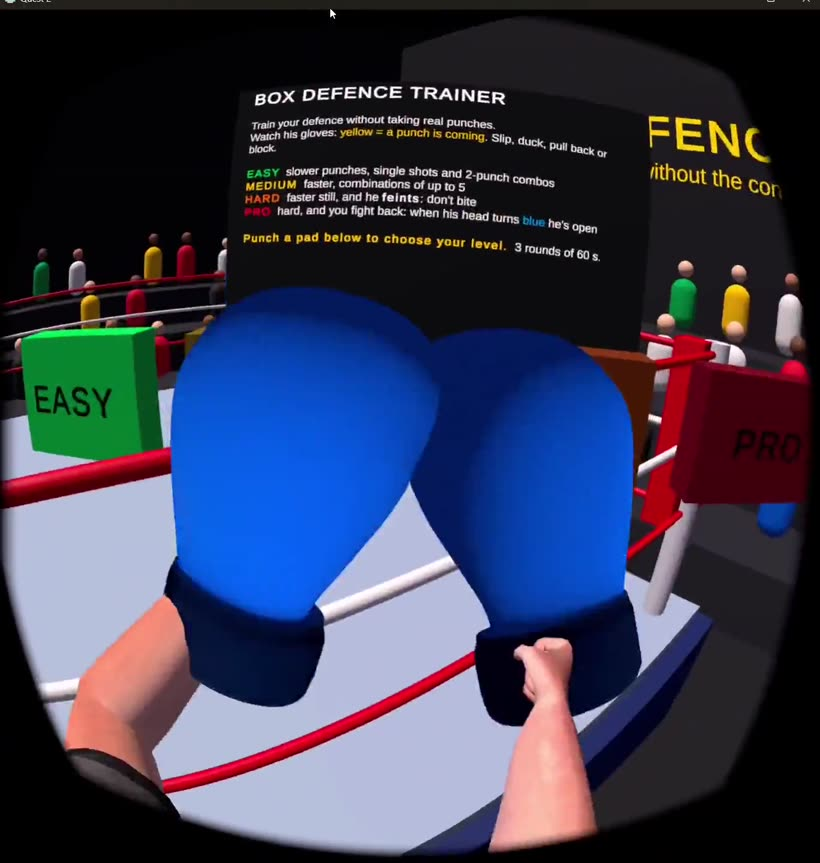
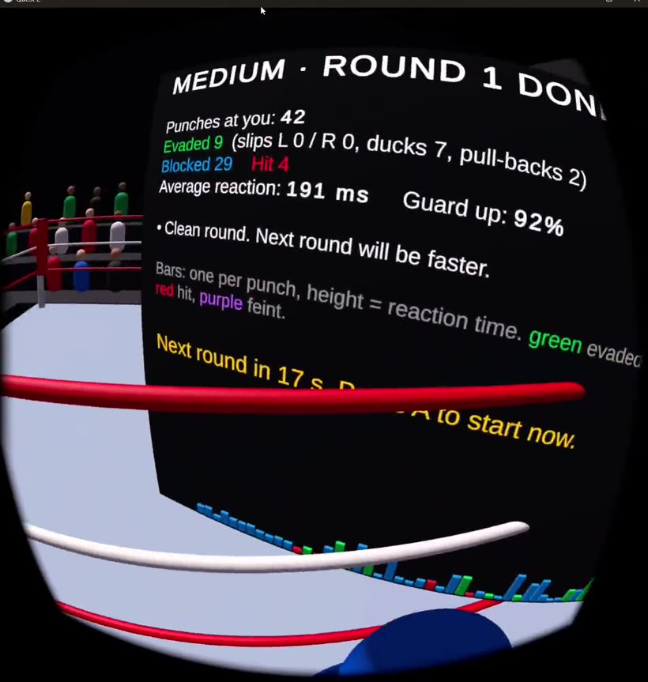

# Box Defence Trainer

**Spar without the concussions.** A VR boxing defence trainer for Meta Quest 2: an opponent throws telegraphed punches, feints and combinations at your real head, and you slip, duck, pull back or block. The headset measures every move. No punch ever lands on a real skull.



**Demo video (1:44):** [Media/demo.mp4](Media/demo.mp4)

## The problem

Defence is learned by being punched at. Sparring is the only realistic way to practise it, and sparring means head impacts. Repeated sub-concussive blows add up, which is why many gyms limit hard sparring and beginners often avoid it altogether. Pad work and shadow boxing are safe, but nothing is coming back at you, so you can't train the reaction itself.

VR can throw a real punch at your real head position. The headset tracks your head in 3D, so it can tell a slip from a duck from a pull-back and time it in milliseconds. A flat screen can't make you move your head out of the way.

## What it does

- **A telegraphed opponent.** His glove pulls back and glows yellow on the wind-up. Then the punch goes for where your head is *now*, so standing still gets you hit.
- **Every punch is classified.** Blocked, slipped left or right, ducked, pulled back, or hit, together with your reaction time.
- **Four levels**, chosen by punching a pad:

  | Level | What changes |
  |---|---|
  | Easy | Slow wind-up (0.62 s), single shots and 2-punch combos |
  | Medium | Faster (0.46 s), combinations of up to 5 |
  | Hard | Faster still (0.34 s), plus **feints**: a wind-up that stops |
  | Pro | Hard, and **you punch back**. When you defend, his hands drop and his head turns blue for 0.9 s |

- **Adaptive difficulty.** Every 6 punches he speeds up if you defend almost everything and slows down if you're getting hit. He also gets 5 % faster each round.
- **Coaching after every round.** Punch counts, reaction time, how long your guard was up, a bar per punch, and one or two concrete tips (for example "You bit on 5 of 5 feints. A glowing glove is not a punch yet").
- **Everything is saved** as JSON on the headset, one file per session.
- **Immersion:** an arena with about 150 fans, runtime-synthesised crowd and punch sounds, controller haptics on hits and blocks, a realistic opponent (Mixamo character), and your own body and gloves.

|  |  |  |
|---|---|---|
| The wind-up glows yellow | Your arms and gloves | The round summary |

## Blog

1. [The idea: sparring without head impacts](BlogPosts/01-the-idea.md)
2. [Building an opponent that punches at your real head](BlogPosts/02-the-opponent.md)
3. [From a toy to a training tool: levels, feints, Pro mode, coaching](BlogPosts/03-training.md)
4. [Immersion: the arena, sound, haptics and a real body](BlogPosts/04-immersion.md)
5. [Testing, results and what I would change](BlogPosts/05-results.md)

## Build and run

You need:

- **Unity 6000.3.7f1** (Unity 6.3 LTS) with the Android Build Support module
- a **Meta Quest 2 or 3** in developer mode, connected by USB

Steps:

1. Clone the repository and open it in Unity Hub.
2. In Unity, choose **BoxDefence → Build Training Scene**. This builds the whole scene from code: the arena, the opponent, your gloves, the menus and the wiring.
3. Choose **BoxDefence → Run Self-Check**. It should report 31 passed, 0 failed.
4. Open **File → Build Profiles**, select **Android**, pick the headset as the run device, and click **Build And Run**.
5. In the headset, open **Library → Unknown Sources → Box Defence Trainer**. Punch a pad to choose a level. **A** or the trigger starts a round early.

To watch on the PC while you play, run `scrcpy --crop=1832:1920:0:0 --max-fps=30`.

## Code

Most of the code lives in `Assets/BoxDefence/`:

```
Scripts/Core/       Pure logic with no scene dependencies, covered by the self-check
  DefenceMath.cs      outcome classification, IK, Bezier paths, guard test, coaching tips
  Records.cs          levels and difficulty presets, per-punch and per-round records
Scripts/
  PlayerRig.cs        head and controller tracking, buttons, haptics
  Opponent.cs         attack loop, punches, feints, hit/block detection, Pro defence
  HumanoidPuppet.cs   drives the Mixamo body: hand IK, height fitting, lean
  PlayerBody.cs       your arms (primitive IK arms, or the real body)
  TrainerSession.cs   menu → countdown → rounds → rest → summary; adaptivity; JSON logging
  LevelMenu.cs, Hud.cs, Feedback.cs   pads, text and bars, sound/flash/haptics
Editor/
  BoxDefenceSceneBuilder.cs   builds the scene from code
  BoxDefenceModels.cs         optional real models; falls back to primitives if missing
  BoxDefenceSelfCheck.cs      31 checks of the core logic
```

About 3,100 lines of C# in 16 files. The scene, materials and wiring are generated, so no step depends on dragging objects around in the editor.

## Credits

- Opponent and player body: **Remy** with the **Fighting Idle** animation, from [Mixamo](https://www.mixamo.com) (Adobe).
- Glove: **"Boxing Glove" by Incg5764** on [Sketchfab](https://sketchfab.com), licensed under [CC Attribution](https://creativecommons.org/licenses/by/4.0/). I converted it from glTF to OBJ and made the texture white so it can be tinted.
- Built with Unity 6 (URP), the XR Interaction Toolkit and OpenXR.

Made by Patrik Klimko for the HMD XR project at VIA University College, 2026.
